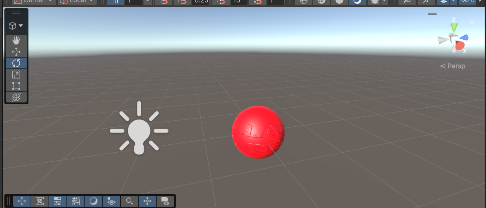

# esfera_light — Parcial Unity (parte práctica)

Esfera roja con un material que usa un normal map con mi nombre, iluminada por una Point Light.

## Versión

- Unity 6 (6000.6.6f1), Built-in Render Pipeline

## Contenido

- **Esfera** con el material `MaterialEsfera`, de color rojo.
- **Normal map** `allan_paredes.png`, creado en GIMP con *Filtros → Genérico → Mapa de normales* e importado en Unity como *Texture Type: Normal map*.
- **Point Light** junto a la esfera (intensidad 3, rango 5).

## Commits

1. Creando esfera
2. Texturizando esfera con normal map
3. Agregando point light
4. Coloreando esfera de rojo

## Cómo abrirlo

En Unity Hub: **Add → Add project from disk**, seleccionar la carpeta `My project` y abrir la escena `Assets/Parcial.unity`.
